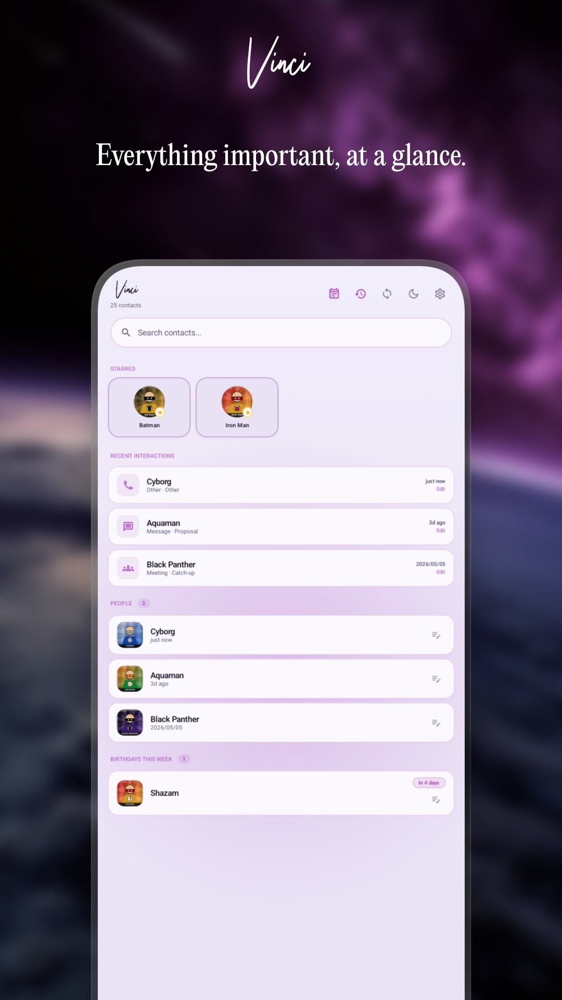
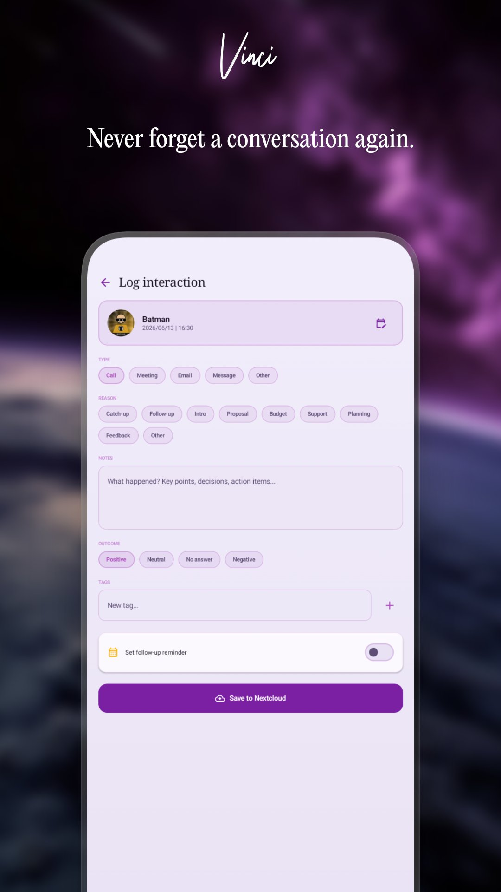
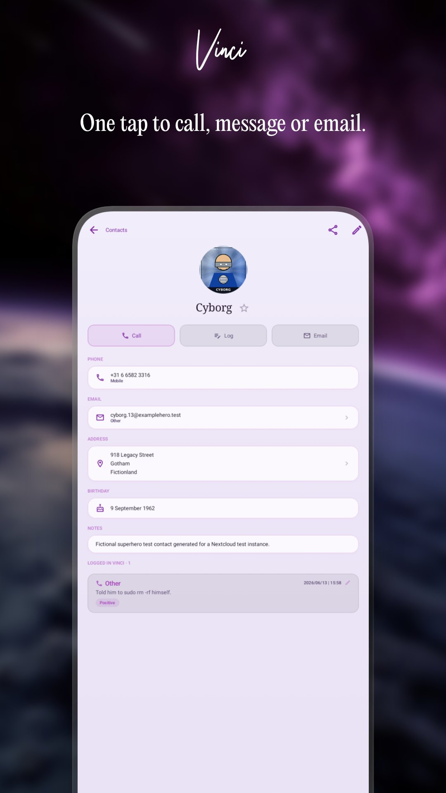
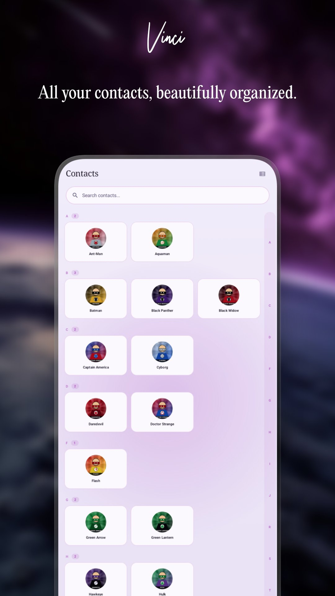
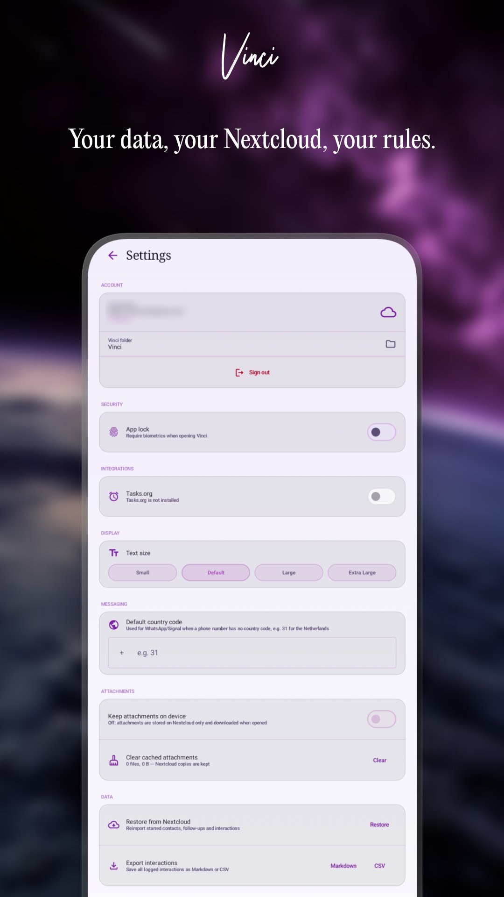
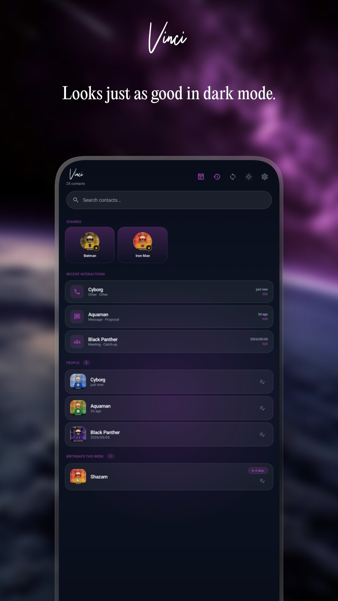

# Vinci — Personal CRM for Nextcloud

> Stay in touch with the people who matter — synced to your own Nextcloud.


[](https://play.google.com/store/apps/details?id=com.brbrs.vinci)
[](https://android.barburas.com/repo)
[](LICENSE)


---

Vinci is a free, open-source, privacy-first personal CRM for Android. Your contacts, interaction history, follow-ups, and relationship notes live entirely on your own Nextcloud — no third-party servers, no tracking, no ads.

---

## Screenshots

| Home | Log Interaction | Contact Detail |
|------|----------------|---------------|
|  |  |  |

| Contacts | Settings | Dark Mode |
|----------|----------|-----------|
|  |  |  |

---

## Features

- **Interaction logging** — Calls, meetings, emails, messages, and social media; log with multiple contacts at once for group calls and meetings
- **Pre-call briefing** — See your last few interactions with a contact before you dial
- **Timeline view** — Vertical timeline with month dividers; toggle between it and the original stacked-card view
- **Company pages** — Automatically created for every organisation in your contacts; see all employees, add an RSS/Atom feed, sync notes to Nextcloud
- **Relationship sparkline** — A 12-week activity chart showing interaction frequency at a glance
- **Caller preview** — Richer notification with your last 2–3 interactions, or a full-screen card over the ringing screen
- **Calendar nudges** — Prompt to log a meeting when attendees match your Vinci contacts
- **Birthday reminders** — Upcoming birthdays on the home screen
- **File & sketch attachments** — Attach files or hand-drawn sketches to an interaction; stored on Nextcloud WebDAV
- **Export** — Interaction history as Markdown or full PDF; full backup as a ZIP file
- **Duplicate / merge assistant** — Spots probable duplicates and merges interaction history in a tap
- **Nextcloud sync** — Native contact sync, no DAVx5 needed; mirrors contacts into Android with live progress; DAVx5 still supported
- **Local-only mode** — Use Vinci without a Nextcloud server; switch modes anytime from Settings
- **Backup & restore** — Export and restore your full history as a ZIP; unmatched contacts are flagged for review, not lost

---

## Requirements

- Android 9 (API 28) or higher
- A self-hosted [Nextcloud](https://nextcloud.com) instance
- [DAVx5](https://www.davx5.com/) (or a compatible CardDAV app) for contact sync
- [Tasks.org](https://tasks.org/) (optional) for follow-up reminders via CalDAV

---

## Privacy

Vinci has no backend. All data — interaction logs, follow-ups, attachments — is stored on **your own Nextcloud**. Vinci never connects to any server other than the one you configure. No analytics, no crash reporting, no ads, no tracking of any kind.

Privacy policy: [barburas.com/privacy-policy](https://barburas.com/privacy-policy)

---

## Building from Source

```bash
git clone https://github.com/andreibarburas/vinci-android.git
cd vinci-android
./gradlew assembleDebug
```

Requires Android Studio Ladybug or newer, JDK 17+.

---

## About Author

Hi, I'm [Andrei Barburas](https://barburas.com). By day, I work at the intersection of information management, intelligence gathering, and human cyber risk; designing systems that make sense of complexity and surface what usually stays unseen, drawing on a background in counter-terrorism research and the behavioral patterns behind radicalization and digital vulnerability. I also lecture in Ethics, Communication Management, and Cross-Cultural Management, and write and teach courses on psychology, culture, and critical thinking.

This corner of GitHub is the other side of that same instinct. I build a small collection of free, open-source tools for people who self-host: a suite of [Android Apps](https://github.com/stars/andreibarburas/lists/android-apps) designed around Nextcloud and selfhosters, along with [Home Assistant Apps](https://github.com/andreibarburas/hassio-apps) and a handful of [Wordpress Plugins](https://github.com/andreibarburas/lists/wordpress-plugins).

I started making these because I wanted something the existing options didn't offer; small, focused tools that fit my own self-hosted setup instead of forcing me to compromise. No ads, no tracking, GPLv3 licensed where applicable, and built to work with the tools people already run at home.

## AI Usage

I'm open about the fact that I use AI throughout development. It genuinely helps me move faster and build things I wouldn't otherwise have time for as one person. But AI doesn't replace the actual work; I still spend the evenings figuring out what something should actually do, testing it against real setups and edge cases, and tracking down the inevitable weird bugs. AI is a tool I use, not a shortcut around the thinking.

## Support

If my work saves you time, a small tip means a lot:

- ⭐ **Donate via Bunq (my bank):** [bunq.me/barburasdonations](https://bunq.me/barburasdonations?description=Donation%20from%20Github)
- 🐈‍⬛ **GitHub Sponsors:** [github.com/sponsors/andreibarburas](https://github.com/sponsors/andreibarburas)
- ☕ **Buy me a coffee:** [buymeacoffee.com/barburas](https://buymeacoffee.com/barburas)
- 🌐 **Website:** [barburas.com](https://barburas.com)
- 🐛 **Issues & feature requests:** [open an issue](../../issues)

## Links

- [Play Store](https://play.google.com/store/apps/dev?id=6842866278906089090) [](https://play.google.com/store/apps/dev?id=6842866278906089090)
- [F-Droid Self-Hosted Repo](https://android.barburas.com/repo) [](https://android.barburas.com/repo)
- [r/BarburasLab](https://reddit.com/r/barburaslab) 
- [Privacy Policy](https://barburas.com/privacy-policy/) [](LICENSE)

## Other work on Github

- [Android Apps](https://github.com/stars/andreibarburas/lists/android-apps)
- [Home Assistant Apps](https://github.com/andreibarburas/hassio-apps)
- [Wordpress Plugins](https://github.com/stars/andreibarburas/lists/wordpress-plugins)

## License

All my work is licensed under the [GNU General Public License v3.0](LICENSE).

You are free to use, study, modify, and redistribute this software, provided that any distributed modifications are also licensed under GPL v3 and the source code remains available.

---

*by [andrei BARBURAS](https://barburas.com)* 